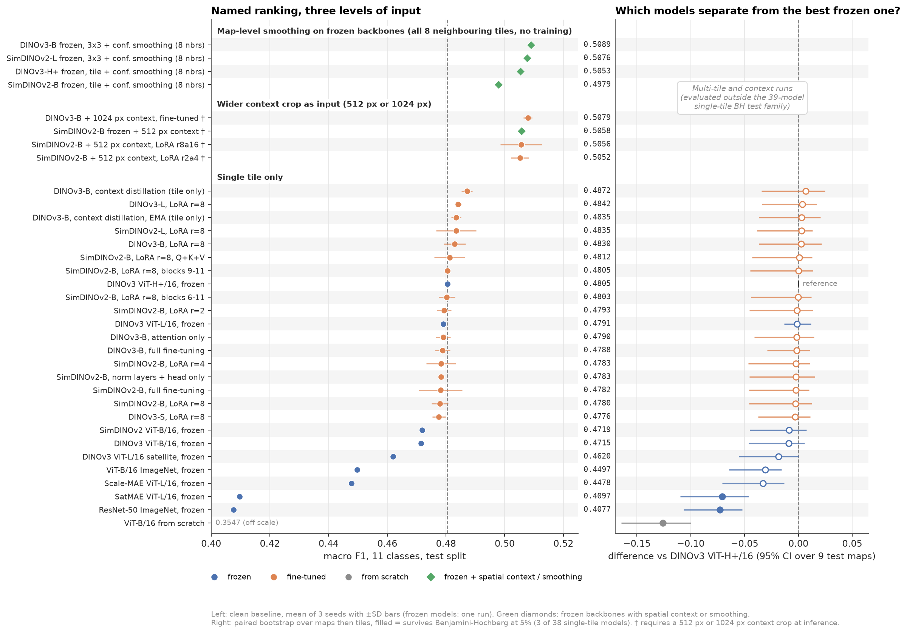
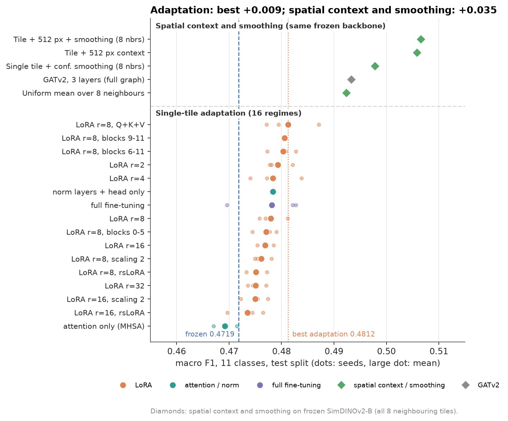
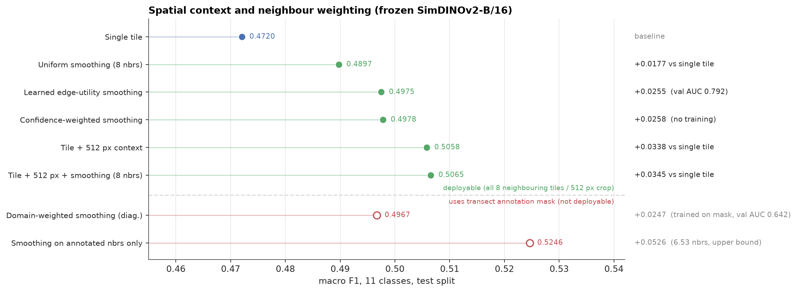
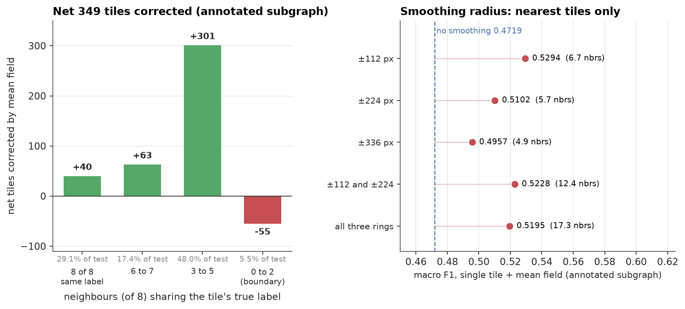
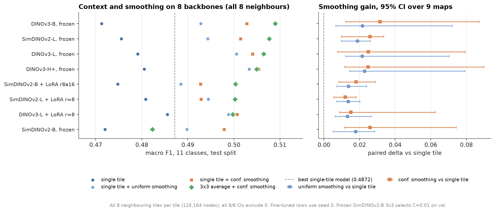
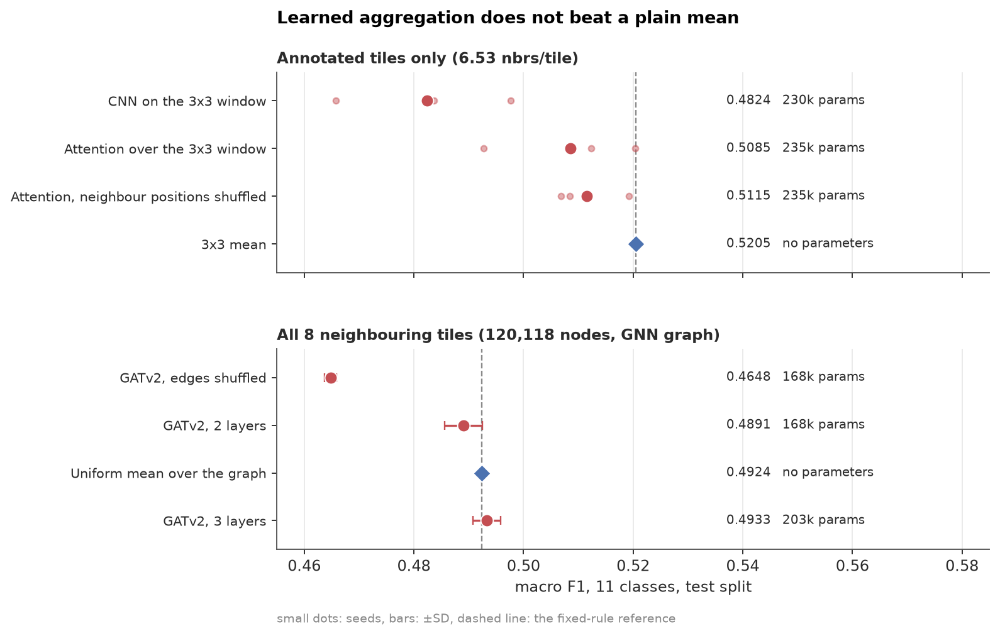
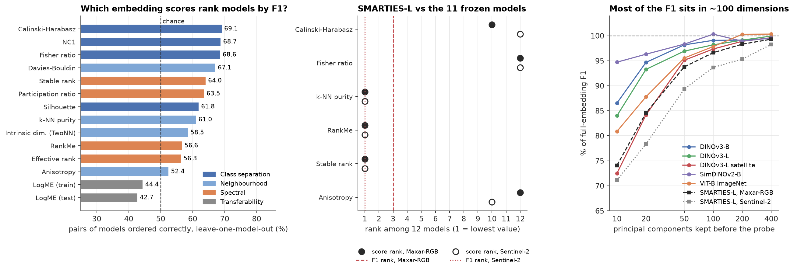
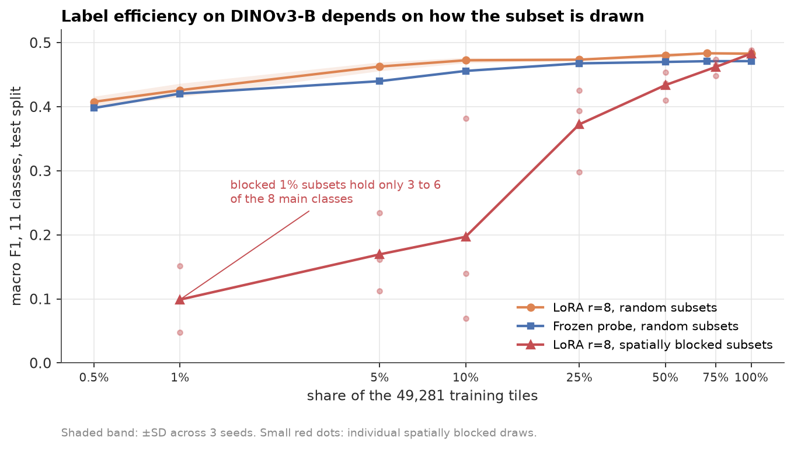
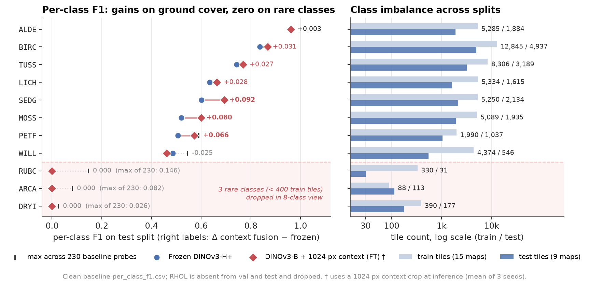
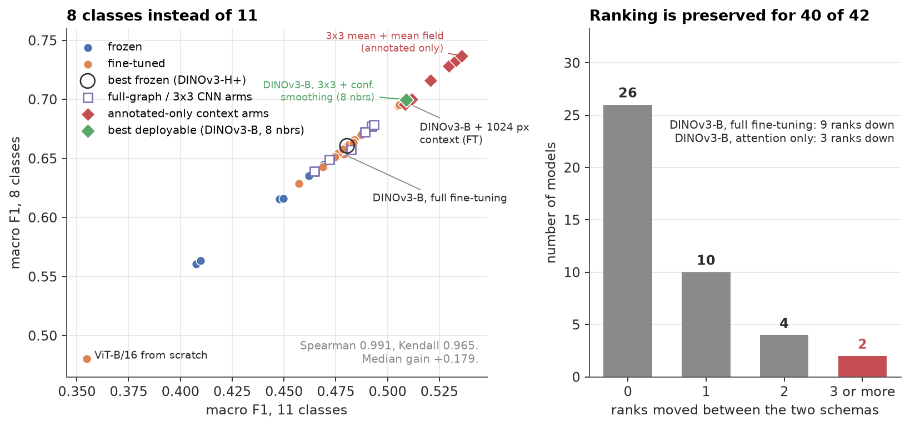

# Arctic-TVC: foundation models for tundra vegetation mapping

[](https://github.com/Lmague/uav-vegetation-vfm/actions/workflows/ci.yml)
[](https://doi.org/10.20383/103.01418)

Code and results for my M.Sc. thesis in computer science (AI) at UQAM, supervised by Mohamed Bouguessa (ML) and Étienne Laliberté (ecology).

The goal is to classify 224 px tiles (~0.5 m across) cropped from Arctic tundra drone orthomosaics (about 2.2 mm/px, 112 px / ~0.25 m stride) into 11 vegetation classes. I compare frozen foundation models, parameter-efficient fine-tuning (PEFT), full fine-tuning, and a from-scratch baseline under one shared linear probe and one orthomosaic-level test split. The main question is simple: on this kind of fine-scale vegetation map, does it help more to use a larger backbone, to fine-tune, or to include the neighbouring tiles around each tile?

Main results:

- Across the DINOv3 and SimDINOv2 models, changing model size or fine-tuning moves macro F1 by at most 0.015. With 9 test orthomosaics, none of these models is significantly different from the best frozen backbone. Only the weakest baselines stand out: SatMAE, frozen ResNet-50 ImageNet, and ViT-B/16 trained from scratch.
- Using neighbouring tiles and spatial smoothing across all 8 neighbouring tiles (including unannotated tiles outside the transects, so deployable on new orthomosaics) raises macro F1 by +0.025 to +0.038 across all 8 backbones (all 95% CIs exclude zero). The best deployable score is 0.5089 (11 classes) / 0.6998 (8 classes), roughly matching a frozen two-view tile + 512 px (~1.1 m) context setup (0.5058). No backbone training is required; only the linear probe is refit.
- Learned neighbour aggregation (self-attention, CNN, GATv2) does not beat fixed averaging or smoothing. Using larger native-resolution crops (384–1024 px without resizing) helps isolated tiles (+0.016 to +0.024) but does not beat tile + 512 px context and hurts 3x3 averaging, smoothing, and GATv2 because adjacent crops overlap too much.
- Restricting smoothing to annotated neighbours only ("good neighbours" along transects) reaches 0.5306–0.5394, but no classifier or edge weighting separates annotated from off-transect neighbours at test time, so real-world smoothing stays around 0.505–0.509.
- Embedding geometry metrics can rank models slightly better than chance, but they do not predict F1 accurately.

My highest deployable score overall is 0.5089 macro F1 (0.6998 on 8 classes), obtained with a frozen DINOv3-B backbone, a 3x3 average over all 8 neighbours, and confidence-weighted mean-field smoothing. Frozen SimDINOv2-L reaches 0.5076, DINOv3-L 0.5065, DINOv3-H+ single tile with confidence-weighted smoothing 0.5053, and frozen SimDINOv2-B with a 512 px zoom-out context patch 0.5058.

Note that these multi-tile recipes use neighbouring tiles at inference time, so they are evaluated separately from the 42 configurations in the main table. Among single-tile models, the best one is DINOv3-B with context distillation at 0.4872. The three fine-tuned context-fusion rows (0.5052 to 0.5079) require both the 224 px tile and a wider context crop at inference (1024 px / ~2.2 m for DINOv3-B at 0.5079; 512 px / ~1.1 m for the two SimDINOv2-B LoRA runs at 0.5056 and 0.5052), so they are marked separately by their input size in the 42-model table.

Contents: [Ranking](#ranking-of-42-configurations) · [Adaptation](#adaptation-methods) · [Context and smoothing](#neighbouring-tiles-and-smoothing) · [Other backbones](#does-it-hold-on-other-backbones) · [Learned aggregation](#learned-aggregation) · [Embedding geometry](#embedding-geometry) · [Data size](#data-size) · [Per class](#per-class) · [Protocol](#protocol) · [Ongoing](#ongoing-work) · [Limits](#limits) · [Reproduce](#reproduce)

## Ranking of 42 configurations



This ranking covers 42 configurations: 11 frozen models and 31 fine-tuned models (3 seeds each). Out of the 42, 39 take a single 224 px tile at inference; the top 3 rows require both the tile and a wider context crop (1024 px for DINOv3-B, 512 px for SimDINOv2-B), so they are deployable on orthomosaics but not comparable as single-tile models. Every model is evaluated with the exact same linear probe. The figure groups the results into three input levels: single tile (top 18 models plus 8 reference models, including frozen DINOv3-B), wider context crops as input, and map-level smoothing. The full 42-model table is folded below.

- Best frozen model: DINOv3 ViT-H+/16 at 0.4805. Best standard LoRA in this ranking: DINOv3-L at 0.4842. The difference is +0.0037 (CI [-0.034, +0.017], q = 0.76), which is not statistically significant.
- After Benjamini-Hochberg correction, only 3 of the 38 single-tile models are significantly different from the best frozen model: SatMAE (-0.071), frozen ResNet-50 ImageNet (-0.073), and ViT-B/16 from scratch (-0.126). All other pairs fail the correction (q > 0.10), even though three of them still have paired 95% CIs excluding zero (ViT-B/16 ImageNet, Scale-MAE, and fine-tuned ResNet-50).
- Satellite-pretrained DINOv3 ViT-L gets 0.4620 vs 0.4791 for the natural-image version of the same architecture (-0.017, CI [-0.058, +0.001], not significant). Scale-MAE (0.4478) and SatMAE (0.4097) are both ViT-L models and still score below frozen ViT-B/16 ImageNet (0.4497), though the architecture size differs so this alone does not isolate the effect of satellite pretraining.
- Adding fine-tuning on top of the 512 px context fusion does not seem to help: the two LoRA variants get 0.5056 and 0.5052 (clean baseline) compared to 0.5058 for the frozen fusion (tile-context run). Since those numbers come from separate runs, this is indicative rather than a paired test.
- The context-fusion and smoothing setups (0.5052 to 0.5089) sit above every single-tile model. Learned aggregation stays lower: the 3x3 CNN gets 0.4824, GATv2 reaches 0.4933 on the full graph, and GATv2 with shuffled edges drops to 0.4648. These setups are outside the Benjamini-Hochberg test family above.
- Non-linear classification heads (MLP, bilinear, FiLM) never beat the linear probe on single-tile features (0 out of 33 groups, mean delta -0.0103). They do slightly better on 2 out of 24 fused groups, both single-seed and without confidence intervals, so I do not count them as reliable gains.

<details>
<summary>All 42 configurations</summary>

| # | Model | Macro F1, 11 classes | Macro F1, 8 classes | Seed SD (11 / 8) | Runs | Input |
|---:|---|---:|---:|---:|---:|---|
| 1 | DINOv3-B + 1024 px context, fine-tuned | 0.5079 | 0.6984 | 0.0015 / 0.0020 | 3 | +1024 px crop |
| 2 | SimDINOv2-B + 512 px context, LoRA r8a16 | 0.5056 | 0.6953 | 0.0071 / 0.0098 | 3 | +512 px crop |
| 3 | SimDINOv2-B + 512 px context, LoRA r2a4 | 0.5052 | 0.6947 | 0.0030 / 0.0042 | 3 | +512 px crop |
| 4 | DINOv3-B, context distillation (tile only) | 0.4872 | 0.6699 | 0.0018 / 0.0025 | 3 | 224 px tile |
| 5 | DINOv3-L, LoRA r=8 | 0.4842 | 0.6657 | 0.0012 / 0.0017 | 3 | 224 px tile |
| 6 | DINOv3-B, context distillation, EMA (tile only) | 0.4835 | 0.6648 | 0.0017 / 0.0024 | 3 | 224 px tile |
| 7 | SimDINOv2-L, LoRA r=8 | 0.4835 | 0.6633 | 0.0068 / 0.0106 | 3 | 224 px tile |
| 8 | DINOv3-B, LoRA r=8 | 0.4830 | 0.6641 | 0.0037 / 0.0051 | 3 | 224 px tile |
| 9 | SimDINOv2-B, LoRA r=8, Q+K+V | 0.4812 | 0.6617 | 0.0052 / 0.0072 | 3 | 224 px tile |
| 10 | SimDINOv2-B, LoRA r=8, blocks 9-11 | 0.4805 | 0.6608 | 0.0001 / 0.0001 | 3 | 224 px tile |
| 11 | DINOv3 ViT-H+/16, frozen | 0.4805 | 0.6606 | n/a / n/a | 1 | 224 px tile |
| 12 | SimDINOv2-B, LoRA r=8, blocks 6-11 | 0.4803 | 0.6604 | 0.0028 / 0.0038 | 3 | 224 px tile |
| 13 | SimDINOv2-B, LoRA r=2 | 0.4793 | 0.6591 | 0.0024 / 0.0033 | 3 | 224 px tile |
| 14 | DINOv3 ViT-L/16, frozen | 0.4791 | 0.6588 | n/a / n/a | 1 | 224 px tile |
| 15 | DINOv3-B, attention only | 0.4790 | 0.6572 | 0.0025 / 0.0047 | 3 | 224 px tile |
| 16 | DINOv3-B, full fine-tuning | 0.4788 | 0.6535 | 0.0025 / 0.0032 | 3 | 224 px tile |
| 17 | SimDINOv2-B, LoRA r=4 | 0.4783 | 0.6577 | 0.0050 / 0.0069 | 3 | 224 px tile |
| 18 | SimDINOv2-B, norm layers + head only | 0.4783 | 0.6577 | 0.0002 / 0.0003 | 3 | 224 px tile |
| 19 | SimDINOv2-B, full fine-tuning | 0.4782 | 0.6575 | 0.0074 / 0.0102 | 3 | 224 px tile |
| 20 | SimDINOv2-B, LoRA r=8 | 0.4780 | 0.6572 | 0.0029 / 0.0039 | 3 | 224 px tile |
| 21 | DINOv3-S, LoRA r=8 | 0.4776 | 0.6567 | 0.0023 / 0.0031 | 3 | 224 px tile |
| 22 | SimDINOv2-B, LoRA r=8, blocks 0-5 | 0.4771 | 0.6560 | 0.0023 / 0.0032 | 3 | 224 px tile |
| 23 | SimDINOv2-B, LoRA r=16 | 0.4769 | 0.6557 | 0.0015 / 0.0021 | 3 | 224 px tile |
| 24 | SimDINOv2-B, LoRA r=8, scaling 2 | 0.4761 | 0.6547 | 0.0017 / 0.0023 | 3 | 224 px tile |
| 25 | SimDINOv2 ViT-L/16, frozen | 0.4756 | 0.6540 | n/a / n/a | 1 | 224 px tile |
| 26 | SimDINOv2-B, LoRA r=8, rsLoRA | 0.4751 | 0.6533 | 0.0020 / 0.0027 | 3 | 224 px tile |
| 27 | SimDINOv2-B, LoRA r=32 | 0.4751 | 0.6532 | 0.0018 / 0.0025 | 3 | 224 px tile |
| 28 | SimDINOv2-B, LoRA r=16, scaling 2 | 0.4750 | 0.6531 | 0.0026 / 0.0036 | 3 | 224 px tile |
| 29 | ViT-B/16 ImageNet, full fine-tuning | 0.4748 | 0.6513 | 0.0015 / 0.0016 | 3 | 224 px tile |
| 30 | SimDINOv2-B, LoRA r=16, rsLoRA | 0.4735 | 0.6497 | 0.0035 / 0.0034 | 3 | 224 px tile |
| 31 | SimDINOv2 ViT-B/16, frozen | 0.4719 | 0.6488 | n/a / n/a | 1 | 224 px tile |
| 32 | DINOv3 ViT-B/16, frozen | 0.4715 | 0.6483 | n/a / n/a | 1 | 224 px tile |
| 33 | SimDINOv2-B, attention only (MHSA) | 0.4692 | 0.6430 | 0.0022 / 0.0031 | 3 | 224 px tile |
| 34 | DINOv3 ViT-S/16, frozen | 0.4689 | 0.6448 | n/a / n/a | 1 | 224 px tile |
| 35 | ViT-B/16 ImageNet, attention only | 0.4686 | 0.6430 | 0.0048 / 0.0082 | 3 | 224 px tile |
| 36 | DINOv3 ViT-L/16 satellite, frozen | 0.4620 | 0.6352 | n/a / n/a | 1 | 224 px tile |
| 37 | ResNet-50 ImageNet, full fine-tuning | 0.4573 | 0.6287 | 0.0033 / 0.0046 | 3 | 224 px tile |
| 38 | ViT-B/16 ImageNet, frozen | 0.4497 | 0.6163 | n/a / n/a | 1 | 224 px tile |
| 39 | Scale-MAE ViT-L/16, frozen | 0.4478 | 0.6157 | n/a / n/a | 1 | 224 px tile |
| 40 | SatMAE ViT-L/16, frozen | 0.4097 | 0.5633 | n/a / n/a | 1 | 224 px tile |
| 41 | ResNet-50 ImageNet, frozen | 0.4077 | 0.5606 | n/a / n/a | 1 | 224 px tile |
| 42 | ViT-B/16 from scratch | 0.3547 | 0.4805 | 0.0115 / 0.0067 | 3 | 224 px tile |

</details>

## Adaptation methods



All 16 adaptation methods tested on SimDINOv2-B/16 end up between 0.4692 and 0.4812, compared to 0.4719 for the frozen backbone. I use SimDINOv2-B as the main testbed here because it is the only backbone where I ran the full 16-regime ablation in the clean baseline. Its frozen F1 is almost identical to DINOv3-B (0.4715, a 0.0004 gap), and the 8-backbone check below shows the same context and smoothing gains on both backbones. None of the 16 adapted versions is significantly better than the frozen model (the best one is LoRA r=8 on Q+K+V at +0.0094, CI [-0.006, +0.020], q = 0.24).

- Going from LoRA rank 2 to rank 32 drops the mean score from 0.4793 to 0.4751, but no pair is statistically different (rank 2 vs rank 32: +0.0042, CI [-0.003, +0.009], q = 0.31), so I cannot confirm a real downward trend.
- Updating only the normalization layers and the linear head gives 0.4783, practically indistinguishable from LoRA r=8 (CI [-0.009, +0.009]); compared to full fine-tuning, the CI is still wide enough to allow up to a +0.021 difference.
- Full fine-tuning is the most sensitive to the random seed: 0.4696 to 0.4827 across 3 seeds.
- Tuning only attention layers (MHSA) drops to 0.4692, which is 0.0027 below frozen, though again not statistically significant (CI [-0.020, +0.008], q = 0.78).

For perspective, the top part of the figure plots spatial context and smoothing on the exact same frozen backbone. Compared to 0.4719 frozen and 0.4812 for the best adaptation, GATv2 on the full graph gets 0.4933, confidence-weighted smoothing gets 0.4978, and adding a 512 px zoom-out patch gets 0.5058 (up to 0.5089 on frozen DINOv3-B with 3x3 averaging and smoothing). Spatial context brings roughly three to four times more gain than adaptation (+0.026 to +0.038 vs +0.009).

## Neighbouring tiles and smoothing



All rows above use frozen SimDINOv2-B/16 embeddings and the canonical linear probe on the full 8-neighbour graph (80,088 annotated tiles plus 40,030–40,076 unannotated neighbouring windows outside the transects).

- Adding uniform mean-field smoothing over all 8 neighbours raises F1 from 0.4720 to 0.4897 (+0.0177). Weighting each neighbour by its prediction confidence `(max_c P_j)^4` (no training required) raises it further to 0.4978 (+0.0258), matching entropy weighting (0.4977).
- Concatenating a 512 px zoom-out context patch (resized to 224 px) reaches 0.5058 (+0.0338), and adding entropy-weighted smoothing on top gives 0.5065.
- Passing larger native-resolution crops directly into the ViT (384, 448, 512, or 1024 px without resizing) improves isolated tiles (+0.016 to +0.024: DINOv3-B 0.4870 at 448 px, SimDINOv2-B 0.4958 at 512 px) and shows that the drop at 1024 px is not caused by downsampling (native 1024 CLS is 0.4417 / 0.3825 vs resized 0.4402 / 0.3879). Even so, combining native crops with the 224 px tile tops out at 0.5046 and hurts 3x3 averaging, smoothing, and GATv2 (0.4717–0.4731) because adjacent crops overlap too much (neighbour cosine similarity jumps from 0.82 to 0.95–0.97).
- Concatenating classical colour and texture descriptors to the tile embedding hurts F1 by 0.004 to 0.005.
- Why keeping only annotated neighbours inflates F1: if smoothing is restricted to annotated tiles along the transects (6.53 neighbours/tile on test instead of 8), F1 jumps to 0.5246–0.5359 (+0.027 to +0.035 higher). The 18.4% off-transect neighbours are real tundra tiles, but their predicted class agrees with the centre tile only 43.0% of the time (vs 68.7% for annotated neighbours). Trying to filter them out at test time does not recover that gap: a diagnostic binary classifier trained on the annotation mask to predict annotated vs off-transect reaches only val AUC 0.642 (test F1 0.4967), and a deployable supervised edge-utility classifier using predicted class, confidence, entropy, direction, and embedding cosine similarity reaches AUC 0.792 but test F1 0.4975, no better than simple confidence weighting (0.4978).



- On the annotated subgraph, out of 349 net tiles corrected by mean-field smoothing, 301 are in mixed neighbourhoods (where 3 to 5 out of 8 neighbours share the tile's true class). Tiles sitting on class boundaries lose accuracy (-55 net tiles).
- Using only the closest ring of neighbours works best (tiles are 224 px / ~0.5 m with a 112 px / ~0.25 m stride, so ±112 px corresponds to 50% overlap): 0.5294 vs 0.5102 at ±224 px and 0.4957 at ±336 px (validation follows the same order: 0.4891 vs 0.4737). Combining multiple rings gives 0.5195 to 0.5228.

## Does it hold on other backbones?



All numbers below use the full 8-neighbour graph (120,164 nodes, no annotation mask; auxiliary embeddings verified against canonical ones at cosine >= 0.99989).

| Backbone | Single tile | + smoothing | + conf. smoothing | 3x3 average | 3x3 + smoothing | 3x3 + conf. smoothing | Best (8 classes) |
|---|---:|---:|---:|---:|---:|---:|---:|
| DINOv3-B, frozen | 0.4713 | 0.4928 | 0.5028 | 0.4976 | 0.5031 | **0.5089** | **0.6998** |
| SimDINOv2-L, frozen | 0.4756 | 0.4943 | 0.5014 | 0.5010 | 0.5017 | 0.5076 | 0.6980 |
| DINOv3-L, frozen | 0.4791 | 0.5006 | 0.5040 | 0.4997 | 0.5036 | 0.5065 | 0.6964 |
| DINOv3-H+, frozen | 0.4805 | 0.5033 | **0.5053** | 0.4993 | **0.5050** | 0.5050 | 0.6943 |
| DINOv3-L + LoRA r=8, seed 0 | 0.4856 | 0.4988 | 0.5007 | **0.5013** | 0.5019 | 0.4998 | 0.6872 |
| SimDINOv2-B + LoRA r8a16, seed 0 | 0.4748 | 0.4885 | 0.4928 | 0.4938 | 0.4941 | 0.5004 | 0.6880 |
| SimDINOv2-L + LoRA r=8, seed 0 | 0.4808 | 0.4944 | 0.4928 | 0.4997 | 0.5002 | 0.5002 | 0.6878 |
| SimDINOv2-B, frozen | 0.4720 | 0.4898 | 0.4979 | 0.4748\* | 0.4784\* | 0.4823\* | 0.6632\* |

*\*On frozen SimDINOv2-B 3x3 average, validation selects `C = 0.01` instead of `0.001`.*

- Smoothing gives a statistically significant gain on all 8 backbones (all 95% hierarchical bootstrap CIs exclude zero): +0.013 to +0.023 for uniform smoothing (p <= 0.015), and +0.012 to +0.031 for confidence-weighted smoothing (p <= 0.010).
- All deployable context setups converge to roughly the same 0.505–0.509 range: 3x3 + confidence smoothing (0.5089), single tile + confidence smoothing on DINOv3-H+ (0.5053, only one 224 px forward pass per tile), frozen tile + 512 px context (0.5058), and native high-resolution fusion (0.5046).

<details>
<summary>Reference: earlier runs restricted to annotated neighbours only (6.53 neighbours/tile)</summary>

| Backbone | Single tile | + smoothing | 3x3 average | 3x3 + smoothing |
|---|---:|---:|---:|---:|
| DINOv3-L, frozen | 0.4791 | 0.5328 | 0.5262 | 0.5394 |
| DINOv3-H+, frozen | 0.4805 | 0.5316 | 0.5238 | 0.5380 |
| DINOv3-B, frozen | 0.4713 | 0.5263 | 0.5241 | 0.5366 |
| SimDINOv2-B, frozen | 0.4720 | 0.5294 | 0.5207 | 0.5362 |
| SimDINOv2-L, frozen | 0.4756 | 0.5344 | 0.5259 | 0.5357 |
| DINOv3-L + LoRA r=8, seed 0 | 0.4856 | 0.5200 | 0.5218 | 0.5353 |
| SimDINOv2-B + LoRA r8a16, seed 0 | 0.4748 | 0.5184 | 0.5217 | 0.5306 |
| SimDINOv2-L + LoRA r=8, seed 0 | 0.4808 | 0.5191 | 0.5254 | 0.5349 |

</details>

### Does PEFT help under context and smoothing?

On the full 8-neighbour graph (`research/tile_context_fullgraph_2026-11-26/out/peft_pairs_fullgraph.csv`), the small single-tile PEFT edge (+0.003 to +0.006) disappears and turns slightly negative across all three pairs once confidence-weighted smoothing is applied:

| Pair | Single tile | Single tile + conf. smoothing | 3x3 + smoothing |
|---|---|---|---|
| DINOv3-L | +0.0064 [-0.041, +0.020] | -0.0034 [-0.078, +0.036] | -0.0017 [-0.107, +0.019] |
| SimDINOv2-B | +0.0028 [-0.011, +0.018] | -0.0051 [-0.058, +0.011] | +0.0157\* [+0.006, +0.039] |
| SimDINOv2-L | +0.0053 [-0.009, +0.013] | -0.0086 [-0.020, +0.004] | -0.0014 [-0.011, +0.046] |

*\*Driven by `C = 0.01` selected on frozen SimDINOv2-B 3x3 average (0.4784).* None of the confidence-weighted contrasts is statistically different from zero with 9 maps, and all three point in favour of the frozen backbone.

## Learned aggregation



- Self-attention over the 3x3 window gets 0.5085 (seeds 0.4928 to 0.5204), below the simple 3x3 average at 0.5205 (-0.012, CI [-0.044, +0.002]).
- Shuffling the neighbour positions inside the 3x3 window leaves attention at 0.5115 vs 0.5085 (paired delta -0.0020, CI [-0.006, +0.005], p = 0.36), so there is no evidence that the attention layer actually exploits spatial layout.
- On the larger graph that also includes unannotated windows, GATv2 is not significantly different from a uniform graph mean: -0.0033 with 2 layers (p = 0.64) and +0.0009 with 3 layers (p = 0.82), while the CIs still allow GATv2 to be roughly 0.05 worse.
- GATv2 does rely on the real graph structure: randomly rewiring the edges drops F1 by 0.024 (CI [+0.014, +0.033]).
- Notice also that the uniform mean on the graph with unannotated windows scores 0.028 lower than the annotated-only 3x3 mean. Because both the input graph and the aggregation differ between those runs, this does not isolate a single cause.

## Embedding geometry



Left panel: across the 35 models in `results/rapport_data/loo_triage.csv`, how often each geometry metric orders a pair of models the same way as their test F1, with the sign and linear fit learned on the other 34 models (leave-one-model-out, 1,190 pairs).

- Class-separation / cluster metrics do best: Calinski-Harabasz 69.1%, NC1 68.7%, Fisher ratio 68.6%, Davies-Bouldin 67.1% (grouped with neighbourhood metrics in the plot), and silhouette 61.8% (chance is 50%).
- Spectral metrics are weaker: stable rank 64.0%, participation ratio 63.5%, RankMe 56.6%, effective rank 56.3% (RankMe measures the effective rank of the embedding matrix). The two LogME transferability scores have near-zero full correlation with test F1 (Spearman -0.043 on train, -0.039 on test); under leave-one-model-out linear regression, pure noise mechanically yields <50% pair accuracy (44.4% and 42.7%), so LogME carries no predictive signal here.
- In practice, these metrics can roughly rank models, but they do not predict F1 values: the error reduction over just predicting the mean F1 is at most around 0.0001 on a tier whose F1 range is about 0.04.
- Because model pairs share models, they are not independent. The p-values come from a per-model Wilcoxon test with Benjamini-Hochberg correction inside each metric family, not from the raw pair count.

Middle panel (exploratory): where frozen SMARTIES-L (ViT-L, mean pooling, tested with both its Maxar-RGB and Sentinel-2 projections) ranks among the 11 frozen models on six geometry scores (1 = lowest value), compared to its F1 rank. SMARTIES is a single extraction outside the clean baseline and outside the 35 models on the left, so it is overlaid separately and does not enter any of the percentages above.

Right panel: keeping only the first 100 PCA components retains 97.4% to 100.3% of the full-embedding F1 across 5 backbones. The two exploratory SMARTIES-L curves (dashed), evaluated with the same script, recover a bit less: 96.6% (Maxar-RGB) and 93.7% (Sentinel-2) at 100 components, and 98.3% / 95.3% at 200 components.

With its Maxar-RGB projection, SMARTIES-L has the lowest RankMe (17.5, whereas the next lowest is Scale-MAE at 79.5), the lowest stable rank (1.8), the highest anisotropy (0.99), and the lowest k-NN purity (0.58) of the 12 models, yet the highest Fisher ratio (0.34). Its F1 is 0.4206 (between SatMAE and Scale-MAE), while the Sentinel-2 projection gets 0.3812 (below every frozen model). Four of the six geometry ranks are identical between the two projections even though their F1 differs by 0.039, so those scores did not pick up that gap. Numbers are in `results/rapport_data/geometry_smarties.csv`, `smarties_probe_f1.csv`, `geometry_models.csv`, and `dim_probe_smarties_*.json`.

## Data size



All curves below use DINOv3-B/16.

- On random subsets, LoRA stays above the frozen probe at every training fraction (+0.005 to +0.023). With only 10% of the training tiles, LoRA reaches 0.4725, roughly matching the frozen probe trained on 100% of the tiles (0.4712).
- On spatially blocked subsets, performance drops sharply compared to random sampling: 0.099 vs 0.426 at 1%, and 0.434 vs 0.480 at 50%. At 1%, spatially blocked subsets only contain 3 to 6 of the 8 main classes. Note that missing classes and spatial shift are mixed together here and were not separated.

## Per class



| Code | Taxon | Train tiles | Test tiles | Frozen DINOv3-H+ | DINOv3-B + 1024 px context (FT) |
|---|---|---:|---:|---:|---:|
| ALDE | Alder | 5,285 | 1,884 | 0.958 | 0.962 |
| ARCA | Arctic-alpine | 88 | 113 | 0.000 | 0.000 |
| BIRC | Birch | 12,845 | 4,937 | 0.837 | 0.867 |
| DRYI | *Dryas* | 390 | 177 | 0.000 | 0.000 |
| LICH | Lichen | 5,334 | 1,615 | 0.635 | 0.663 |
| MOSS | Moss | 5,089 | 1,935 | 0.520 | 0.600 |
| PETF | *Petasites* | 1,990 | 1,037 | 0.506 | 0.572 |
| RUBC | *Rubus* (*R. chamaemorus*) | 330 | 31 | 0.000 | 0.000 |
| SEDG | Sedge | 5,250 | 2,134 | 0.601 | 0.694 |
| TUSS | Tussock | 8,306 | 3,189 | 0.742 | 0.769 |
| WILL | Willow | 4,374 | 546 | 0.486 | 0.460 |

Three classes get an F1 of exactly zero for both models (across all 3 seeds for context fusion, and in the single run for frozen DINOv3-H+). Across all 230 probes in the clean baseline, the highest scores ever reached on those classes are 0.082 (ARCA), 0.026 (DRYI), and 0.146 (RUBC). Because these are the rarest classes, they pull the 11-class macro F1 down for every model, so it makes more sense to compare models relative to each other than to judge the absolute macro F1 alone. A twelfth class (RHOL, Rhubarb) does not appear in validation or test and is excluded.

### The same ranking on the 8 remaining classes



The scatter plot shows the 42 configurations along with the annotated-only context arms (red diamonds), the full-graph / 3x3 CNN arms (hollow purple squares), and the best deployable full-graph setup (green diamond, DINOv3-B 3x3 + confidence-weighted smoothing at 0.5089 / 0.6998). The rank-change bar chart on the right covers only the 42 configurations.

Since ARCA, DRYI, and RUBC stay close to zero for all models, they lower macro F1 without really helping separate models. The 8-class view leaves them out of the macro average (321 out of 17,598 test tiles) while keeping the exact same 11-class classifier: their tiles remain in the test set, so a kept class predicted on those tiles still counts as a false positive, and a kept tile predicted as one of those three still counts as a false negative. Those three classes are simply excluded from the mean. This matches the `f1_macro_8cls_test` convention logged by training runs, and is not a classifier retrained on 8 classes (earlier 8-class refits used a different protocol and are not used here). Note also that `f1_8cls` in `recipe_comparisons.json` and `gnn_canonical.json` removes the 321 tiles before scoring, which is roughly +0.006 higher; the table and figure below use the first convention.

- Dropping the three rare classes raises macro F1 by about 0.18 (median +0.179): the 42 configurations go from 0.3547–0.5079 (11 classes) to 0.4805–0.6984 (8 classes).
- The model ordering almost does not change: Spearman 0.991, Kendall 0.965. 26 models keep the exact same rank, 10 move by 1 place, 4 by 2 places, and only 2 move by 3 or more.
- Those two models are DINOv3-B with full fine-tuning (9 places down) and DINOv3-B with attention-only tuning (3 places down). That shift comes entirely from the three dropped classes, which account for 3/11 of the 11-class average: DINOv3-B full has the highest ARCA F1 among the 42 models (0.039, worth about +0.0035 in macro F1). Only nine models get a non-zero ARCA score, and none exceeds 0.040.
- On the full 8-neighbour graph, the best deployable setup reaches 0.5089 in 11 classes and 0.6998 in 8 classes (frozen DINOv3-B, 3x3 average + confidence-weighted smoothing).

Rows are sorted by ascending 8-class F1; the last column indicates which run each value comes from.

| Arm | 11 classes | 8 classes | Run |
|---|---:|---:|---|
| GATv2, edges shuffled | 0.4648 | 0.6391 | aggregation |
| Single tile | 0.4719 | 0.6489 | decoding |
| CNN on the 3x3 window | 0.4824 | 0.6575 | probe-arms |
| GATv2, 2 layers | 0.4891 | 0.6725 | aggregation |
| Uniform mean over the graph | 0.4924 | 0.6770 | aggregation |
| GATv2, 3 layers | 0.4933 | 0.6783 | aggregation |
| Attention over the 3x3 window (annotated only) | 0.5085 | 0.6957 | probe-arms |
| Attention, positions shuffled (annotated only) | 0.5115 | 0.6999 | probe-arms |
| 3x3 mean (annotated only) | 0.5207 | 0.7160 | decoding |
| Single tile + mean field (annotated only) | 0.5297 | 0.7284 | decoding |
| 3x3 mean + ICM (annotated only) | 0.5332 | 0.7331 | decoding |
| 3x3 mean + mean field (annotated only) | 0.5359 | 0.7369 | decoding |

These setups correspond to the red diamonds (annotated-only) and hollow purple squares (full-graph / 3x3 CNN) in the figure above. Single tile is 0.6488 in the 42-configuration table (clean baseline) and 0.6489 here (decoding run).

## Protocol

| Item | Value |
|---|---|
| Data | Arctic-TVC, drone orthomosaics at about 2.2 mm/px (224 px ≈ 0.5 m), Trail Valley Creek, NWT. [doi:10.20383/103.01418](https://doi.org/10.20383/103.01418) |
| Split | By whole orthomosaic (no tile leakage): 15 train, 8 val, 9 test (49,281 / 13,209 / 17,598 tiles) |
| Classes | 11 (RHOL removed). Metric: macro F1 over the 11 classes |
| Probe | Multinomial logistic regression (lbfgs), C in {1e-4, 1e-3, 0.01, 0.1, 1, 10} selected on val |
| Intervals | Paired hierarchical bootstrap (orthomosaic then tile), 10,000 replicates, Benjamini-Hochberg within a pre-declared family |
| Determinism | seed 42, single-thread BLAS (changing the BLAS thread count alone shifts F1 by about 0.0015) |

## Ongoing work

The follow-up work currently in progress tests whether these findings hold beyond Arctic-TVC.

A second dataset (Léo) covers four aerial sites in southern Québec, with about 355k nadir tiles at 224 px. I use it for external validation rather than extra training data for the benchmark above, and no results from it are reported in this README yet.

For self-supervised pretraining on Léo, `leo-explora-ssl/` adapts a SimDINOv2-B/16 checkpoint on Léo tiles using an ExPLoRA-style setup (LoRA on early blocks, DINO + iBOT + KoLeo, EMA teacher, 3 seeds) and probes the checkpoints back on Arctic-TVC. So far the result is negative: across all 10 checkpoints (epochs 5 to 50, mean of 3 seeds), the adapted features stay below frozen SimDINOv2-B in both the 3x3 context view (-0.002 to -0.013 vs 0.4932) and the fused view (-0.007 to -0.017 vs 0.5059). On single tiles, it only reaches parity by epoch 50 (+0.0005 vs 0.4721). Because the frozen baseline is a single deterministic run, there is no paired CI here and the consistent 10-out-of-10 pattern is the main evidence. A 50-epoch run may still be under-trained, so a longer run is not ruled out. Results are in `results/leo_explora_ssl/`.

On domain shift, a first pilot found a correlation between distribution discrepancy (MMD, optimal transport) and transfer performance, and that association replicated in a second experiment. However, I could not show that discrepancy adds information beyond RankMe, so I do not make any claim about it yet. Discrepancy-guided alignment is on hold until a discrepancy score shows clear added value over RankMe.

## Limits

- Having only 9 test orthomosaics limits statistical power. Confidence intervals are wide, and percentile intervals are not symmetric around the point estimate (for instance +0.0152 with CI [+0.006, +0.062]). They should be read mainly as "excludes zero or not" rather than as tight error bars. I did not run equivalence tests: with 9 maps, this setup can reliably detect differences of about 0.03 to 0.05, while smaller gaps remain unresolved rather than proven equal. For a few pairs, the CI and p-value disagree (e.g., fine-tuned ResNet-50 ImageNet vs best frozen: CI [-0.061, -0.015], p = 0.094, q = 0.22); following the protocol, I report the Benjamini-Hochberg decision, so that pair does not pass.
- Scores in the ranking, adaptation, and geometry sections come from the clean baseline (2026-10-08). The context, smoothing, and aggregation results come from their own runs: frozen single-tile SimDINOv2-B/16 varies slightly between 0.4718 and 0.4720 across runs, the 3x3 mean is 0.5205 or 0.5207, and the full 8-neighbour graph has 120,118 nodes in the GNN run vs 120,164 in the multi-backbone extraction (46 edge windows). Every paired comparison is computed within the same run.
- Frozen backbones are deterministic single runs, so seed SD is not defined for them.
- Context and smoothing are tested across eight backbones (five frozen, three LoRA at seed 0). GATv2 and the other learned aggregation variants are tested on SimDINOv2-B/16 only.
- Invalid ExPLoRA runs and deprecated single-seed fine-tunes (`resnet50_arctic`, `vitb16_arctic`, `vitb16_fulft_arctic`) are excluded from the ranking.

## Reproduce

Cloning this repository gives you all the code, configs, 11-class splits, and scalar tables needed to verify every number above. The raw orthomosaics (public on FRDR), 224 px tile images, extracted embeddings, and model weights (some gated) are not included.

From a fresh clone, you can rebuild all ten figures directly from the committed tables without PyTorch or a GPU:

```bash
pip install -r requirements-figures.txt   # numpy, pandas, scipy, matplotlib
python scripts/make_readme_plots.py       # rebuilds all ten figures from results/
# or simply: make figures
```

Running the full pipeline from scratch requires downloading Arctic-TVC, tiling the orthomosaics, and a GPU for extraction or fine-tuning:

```bash
pip install -r requirements.txt

# 12-class split CSVs are committed; this regenerates the 11-class splits
python scripts/generate_splits_11cls.py --splits-dir splits --out-dir splits --force

# single-tile feature extraction, canonical linear probe, and latent geometry
python extract.py --config configs/frozen_dinov3_lvd.yaml
python probe.py   --config configs/frozen_eval.yaml --only dinov3_vitb16_lvd
python analyze.py --config configs/frozen_eval.yaml --only dinov3_vitb16_lvd

# deployable 8-neighbour 3x3 average + confidence-weighted smoothing (requires auxiliary tile embeddings)
python research/tile_context_fullgraph_2026-11-26/run_multibackbone_fullgraph.py
```

Two practical notes:

- The committed splits are the canonical ones, generated from `splits/split_v3_assignment.json` (15 / 8 / 9 orthomosaics, verified against the CSVs). Both 12-class and 11-class CSVs are included, and the command above reproduces the 11-class CSVs byte-for-byte from the 12-class ones. The raw raster tiling scripts are not published in this repo.
- Fine-tuning requires GPUs and access to gated weights. Per-seed fine-tuned scores are committed in `results/baseline_clean_2026-10-08/per_seed.csv`, so you do not need a GPU to verify the tables or regenerate the figures.

## Where the numbers come from

| Section | Values | File |
|---|---|---|
| Ranking, adaptation, per class, 8-class view | per-seed and per-class F1 | `results/baseline_clean_2026-10-08/per_seed.csv`, `per_class_f1.csv` |
| Significance of the ranking | paired differences, CIs, q-values | `results/baseline_clean_2026-10-08/statistics/pairwise_effects.csv`; predictions and protocol in `preds/` and `statistics/STATISTICAL_PROTOCOL.md` |
| Context, smoothing, learned aggregation | F1, deltas, CIs | `results/tile_context_2026-11-01/*.json` |
| Embedding geometry | pair ordering, LOO, PCA dim-probe | `results/rapport_data/loo_triage.csv`, `dim_probe_summary.csv`, `geometry_models.csv` |
| Data size | learning curves, blocked subsets | `results/datacurve_lora/*_agg.csv`, `lora_spatial_v2/results_spatial_summary.csv`, `spatial_datacurve/class_composition.csv` |
| Per-class table | tile counts, per-class F1 | `splits/*_11cls.csv`, `per_class_f1.csv` |
| Non-linear readouts | 0 of 33, 2 of 24 | `results/rapport_data/head_sweep_summary.csv` |
| Context and aggregation arms, 8 classes | 12 arms, two schemas | `results/tile_context_2026-11-01/arms_8cls.csv` |
| Context and smoothing on 8 backbones (full 8-neighbour graph) | F1, paired deltas, 8-class | `research/tile_context_fullgraph_2026-11-26/out/multibackbone_smoothing_fullgraph.csv` |
| PEFT against its frozen backbone (full 8-neighbour graph) | paired differences | `research/tile_context_fullgraph_2026-11-26/out/peft_pairs_fullgraph.csv` |
| Neighbour weighting and domain/utility classifiers | val/test F1, AUCs, agreement | `research/gnn_grid_2026-10-31/out/decoding_full/weighted_fullgraph.json`, `weighted_fullgraph_r2.json` |
| Native-resolution control (384–1024 px) | probes, fusion, geometry, smoothing | `research/native_scale_2026-11-26/{out/summary,followup/*,fullgraph/fullgraph_probes_mf}.json` |
| Context and smoothing on 8 backbones (annotated only) | F1, paired deltas | `results/tile_context_2026-11-01/multibackbone_smoothing.csv` |
| PEFT against its frozen backbone (annotated only) | paired differences | `results/tile_context_2026-11-01/peft_pairs.csv` |
| Deployable or upper bound | flag per configuration | `results/baseline_clean_2026-10-08/summary.csv` |

Two 8-class scoring conventions appear in the committed files: `arms_8cls.csv` and `per_class_f1.csv` keep the 321 test tiles from the three dropped classes (matching `f1_macro_8cls_test`), whereas `f1_8cls` in `recipe_comparisons.json` and `gnn_canonical.json` removes those tiles before scoring (about +0.006 higher). The README table and figures use the first convention.

Repository layout: `src/` core package, `extract.py` / `probe.py` / `train.py` / `analyze.py` entry points, `configs/` YAML configs, `scripts/` analysis and SLURM scripts, `research/gnn_grid_2026-10-31/code/` tile context, smoothing and GNN code, and `results/` scalar outputs.

Arctic-TVC is publicly available on FRDR under its own licence ([doi:10.20383/103.01418](https://doi.org/10.20383/103.01418)). Code (Python, YAML, Makefile, CI) is under the [MIT License](LICENSE); figures and result tables (PNG, PDF, JSON, CSV) are under [CC-BY-4.0](LICENSE-DATA). Citation metadata is in [CITATION.cff](CITATION.cff).
